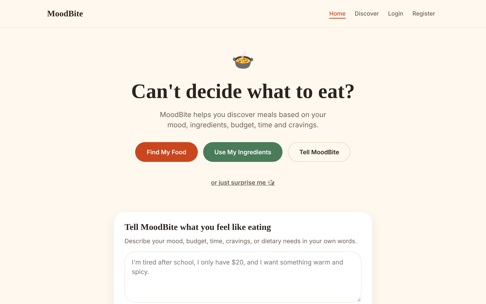
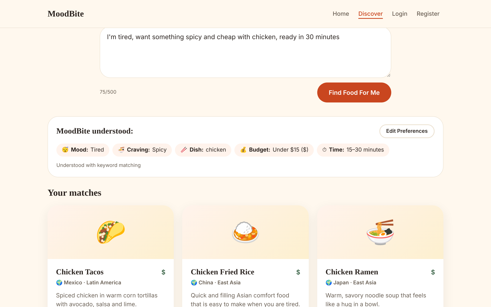
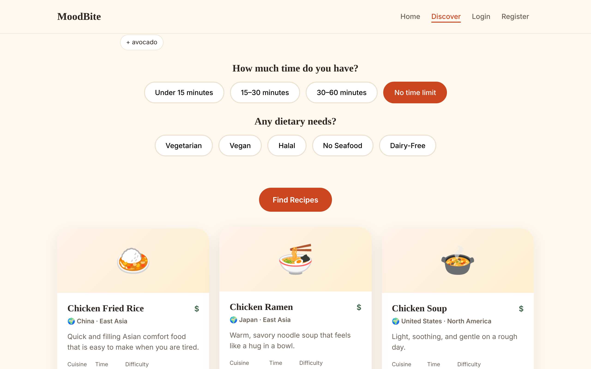
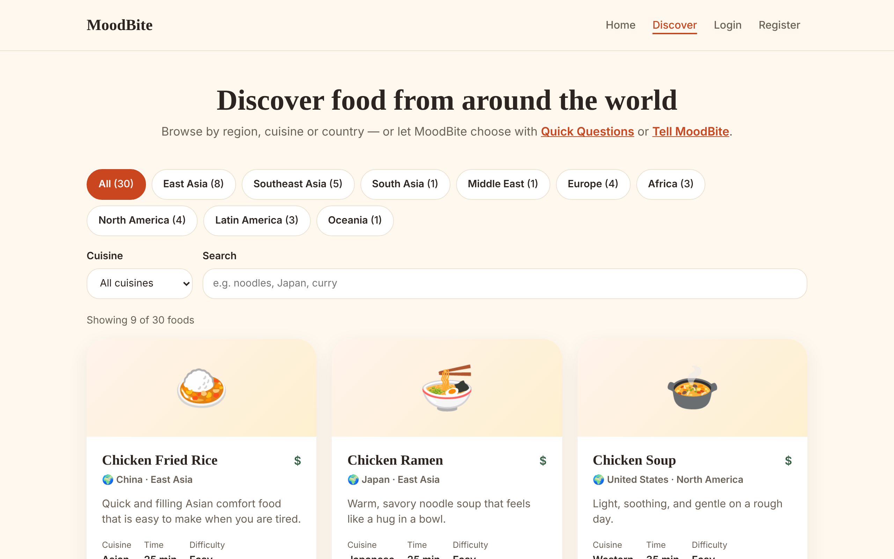
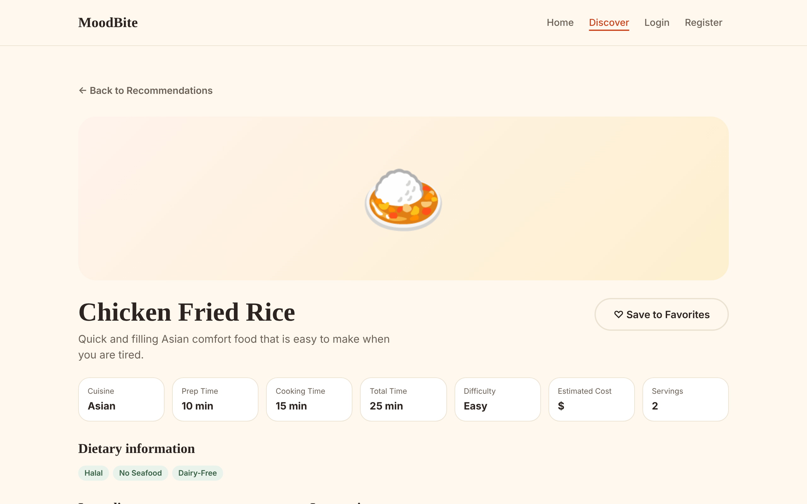
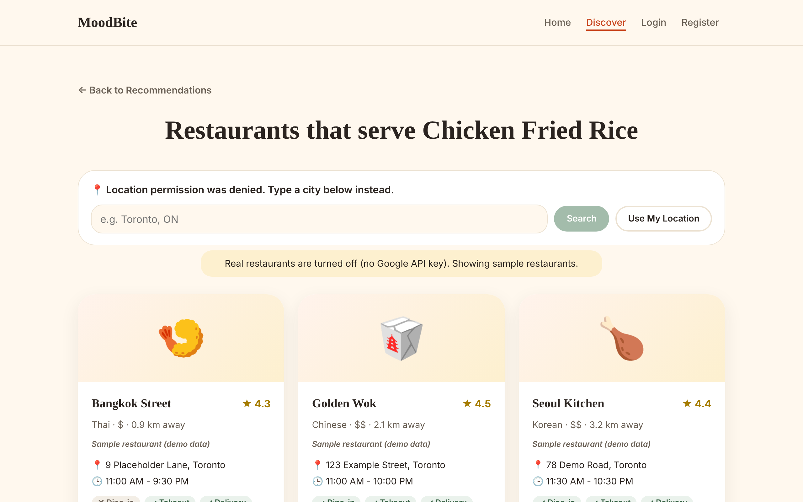
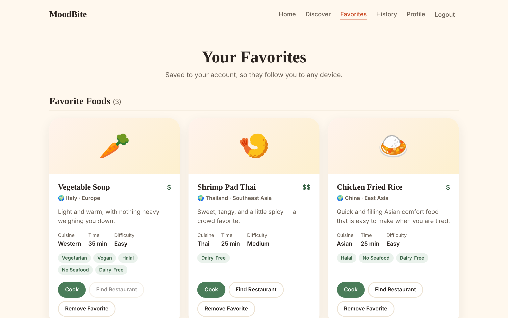
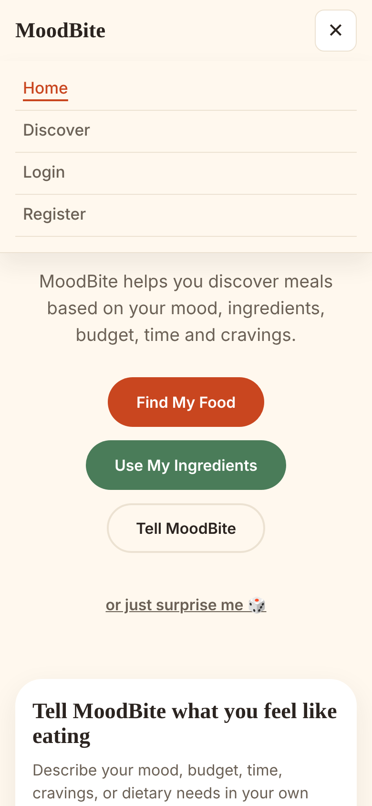

# Whisfood


**Can't decide what to eat?** MoodBite is a full-stack food recommendation web app.
Tell it your mood, the ingredients you have, or just type what you feel like
eating in your own words. It recommends meals from around the world, explains
*why* each one fits, and shows the recipe or nearby restaurants.

> Built by Chhay Khy Lim, Software Engineering student, as a portfolio project.



---

## About

Choosing food takes longer than it should. MoodBite turns that into a short
conversation. Pick a mood, list what's in your fridge, or write
*"I'm tired and want something spicy and cheap, ready in 30 minutes"*.
The backend turns that sentence into structured preferences: mood, craving,
budget, time, cuisine and dietary needs. A scoring engine then ranks 30 dishes
from 20 countries.

## Features

- **Three ways to find food**
  - **Find My Food**: pick a mood, then cravings, budget, time and dietary needs.
  - **Use My Ingredients**: add what you have (e.g. rice, egg, chicken) and get recipes that use them.
  - **Tell MoodBite**: describe what you want in plain English. A keyword NLP parser understands it,
    including negation ("no seafood", "not spicy"). An AI parser can be turned on as an option.
- **Explained results**: every recommendation says why it was picked.
- **Discover page**: browse dishes by region, country and cuisine, with search.
- **Recipes**: step-by-step cooking instructions.
- **Nearby restaurants**: real results from the Google Places API, shown on a Google map.
  Without an API key, clearly labelled sample restaurants are shown instead.
- **Accounts** (JWT login):
  - favorites
  - recommendation history with "View again"
  - profile editing
  - protected pages
- **Responsive and accessible**:
  - mobile menu
  - keyboard navigation and a skip link
  - visible focus, 44px touch targets
  - screen-reader labels
- **Tested**: 50 backend tests and 30 frontend tests, run automatically on every push with GitHub Actions.

## Tech Stack

| Layer | Technology |
|---|---|
| Frontend | React 18, Vite 5, React Router 6, JavaScript, CSS |
| Backend | Python 3, Flask 3 (Blueprints), Flask-CORS, Gunicorn |
| Database | MongoDB Atlas with PyMongo |
| Auth | JWT (PyJWT), Werkzeug password hashing |
| APIs | Google Places API (New), Google Maps JavaScript API |
| NLP | Rule-based keyword parser in Python, optional Claude API parser |
| Testing | pytest + mongomock (backend), Vitest + Testing Library (frontend) |
| CI / Deploy | GitHub Actions; Vercel (frontend) + Render (backend) |

> Note: the original project spec mentioned MySQL. I switched to **MongoDB**
> in Stage 3 because each food has nested data (a recipe, a list of
> ingredients and tags), which fits a document database naturally.

## Architecture

```
 Browser (React + Vite)                Flask REST API                  Data / services
┌───────────────────────┐   JSON    ┌──────────────────────────┐    ┌──────────────────┐
│ pages/ components/    │ ───────▶  │ routes/   (URLs)         │──▶ │ MongoDB Atlas    │
│ context/ (auth, favs) │ ◀───────  │ services/ (logic: NLP,   │    │ foods, users,    │
│ services/apiService.js│  + JWT    │   scoring, auth, places) │    │ favorites,history│
└───────────────────────┘           │ models/   (doc → JSON)   │──▶ │ Google Places API│
                                    └──────────────────────────┘    │ (optional) AI API│
                                                                    └──────────────────┘
```

- **One API address** for the whole frontend: `frontend/src/services/apiService.js` reads `VITE_API_URL`.
- **Routes stay thin**: they read the request, call a service, and return JSON.
- **Services hold the logic**:
  - `nlp_service.py` turns text into preferences.
  - `recommendation_service.py` scores and ranks foods.
  - `places_service.py` talks to Google.
- **Every error is JSON** with a friendly message, e.g. `{"error": "Route not found"}`, never a stack trace.

### How a recommendation is scored

First, foods that break a **hard rule** are removed: they must follow every
dietary need (e.g. vegan + halal) and fit "cook" vs "eat out". Every
remaining food then earns points:

| Match | Points |
|---|---|
| Mood | +3 |
| Each craving (spicy, comfort...) or named dish ("noodles") | +3 |
| Cook / eat-out choice, time limit | +2 each |
| Cuisine ("Korean") | +2 |
| Budget, each ingredient you have | +1 each |

The highest scores win, and each result gets a human-readable explanation.

## Screenshots

| Tell MoodBite (NLP) | Use My Ingredients |
|---|---|
|  |  |

| Discover | Recipe |
|---|---|
|  |  |

| Restaurants | Favorites | Mobile |
|---|---|---|
|  |  |  |

## Installation

You need **Python 3.10+**, **Node.js 18+**, and a free **MongoDB Atlas** cluster
(or a local MongoDB).

```bash
git clone https://github.com/Lim-Chhay-Khy/Moodbite.git
cd Moodbite
```

### 1. Backend

```bash
cd backend
python -m venv venv
venv\Scripts\activate          # Windows   (macOS/Linux: source venv/bin/activate)
pip install -r requirements.txt
copy .env.example .env         # macOS/Linux: cp .env.example .env
```

Fill in `backend/.env` (see [Environment Variables](#environment-variables)), then:

```bash
python seed.py                 # adds the 30 sample foods (accounts are not touched)
python app.py                  # API on http://localhost:5000  (check /api/health)
```

### 2. Frontend (in a second terminal)

```bash
cd frontend
npm install
copy .env.example .env         # optional: only needed for the Google map
npm run dev                    # open http://localhost:5173
```

### Optional demo account

Add `DEMO_PASSWORD=<a new password>` to `backend/.env` and run
`python seed.py --demo`. This creates `demo@moodbite.app`. The password is
never stored in the code.

## Environment Variables

**`backend/.env`** (never commit this file; `.gitignore` already excludes it)

| Variable | Required | Purpose |
|---|---|---|
| `MONGODB_URI` | ✅ | MongoDB connection string (Atlas `mongodb+srv://...`) |
| `MONGO_DB_NAME` | | Database name (default `Moodbite`) |
| `JWT_SECRET_KEY` | ✅ | Long random secret that signs login tokens |
| `SECRET_KEY` | | Flask secret key |
| `FRONTEND_URL` | | Allowed frontend address(es) for CORS, comma-separated |
| `PORT` | | Port for `python app.py` (default 5000) |
| `FLASK_DEBUG` | | `1` locally, `0` in production |
| `GOOGLE_PLACES_API_KEY` | | Turns on real nearby restaurants |
| `AI_API_KEY`, `AI_MODEL` | | Turns on the optional AI parser |
| `DEMO_PASSWORD` | | Only for `python seed.py --demo` |

Generate a secret: `python -c "import secrets; print(secrets.token_hex(32))"`

**`frontend/.env`** (values starting with `VITE_` are public, so only put browser-safe keys here)

| Variable | Purpose |
|---|---|
| `VITE_API_URL` | Backend address, e.g. `http://localhost:5000` or your Render URL |
| `VITE_GOOGLE_MAPS_API_KEY` | Maps JavaScript key, **restricted to your website address** |
| `VITE_GOOGLE_MAP_ID` | Optional map style ID |

## Testing

**Backend**: 50 pytest tests covering auth, foods, recommendations, favorites,
history, the NLP parser and security limits. They use **mongomock**, a fake
in-memory MongoDB, so they never touch real data and need no secrets.

```bash
cd backend
pip install -r requirements-dev.txt
pytest -q
```

**Frontend**: 30 Vitest + Testing Library tests for the components, the
protected route, the login form, the recipe page and validation.

```bash
cd frontend
npm test
```

Both suites run automatically on GitHub after every push (`.github/workflows/tests.yml`).
For the manual checklist I use before a release, see [docs/TESTING.md](docs/TESTING.md).

## Deployment

The frontend goes on **Vercel**, the backend on **Render** (run with `gunicorn app:app`),
and the database stays on **MongoDB Atlas**. For step-by-step instructions, see
[docs/DEPLOYMENT.md](docs/DEPLOYMENT.md).

## Security

What is implemented:

- Passwords are hashed and salted, never stored as text. Login errors don't reveal which emails exist.
- JWT tokens expire. Protected routes check the token, and users can only see or delete their own favorites and history.
- All input is validated on the server, with length limits. Request bodies over 100 KB are rejected.
- CORS only allows the configured frontend address. Basic security headers (`nosniff`, `DENY` framing) are added to every response.
- Secrets live only in `.env` files, which are git-ignored. Server-only keys (database, JWT, Google Places, AI) never reach the browser.
- Users only ever see friendly JSON errors. Details go to the server log.

What a real production app would still need: rate limiting on login,
refresh tokens or httpOnly cookies instead of localStorage, HTTPS-only
cookies, and monitoring. **This is a portfolio project, not a
security-audited product.**

## Project Structure

```
├── backend/
│   ├── app.py              Flask app, CORS, error handlers
│   ├── config.py           reads settings from .env
│   ├── database.py         MongoDB connection + indexes
│   ├── routes/             one file per API area (auth, foods, favorites...)
│   ├── services/           business logic (NLP, scoring, auth, Google Places)
│   ├── models/             turn MongoDB documents into JSON
│   ├── tests/              pytest tests
│   ├── seed.py, seed_data.py
│   └── requirements.txt, Procfile
├── frontend/
│   ├── src/pages/          one component per page
│   ├── src/components/     reusable UI (cards, navbar, inputs...)
│   ├── src/context/        auth, favorites and app state
│   ├── src/services/       apiService.js: every call to the backend
│   └── vercel.json
├── docs/                   TESTING.md, DEPLOYMENT.md, screenshots/
├── render.yaml             Render deployment settings
└── .github/workflows/      automatic tests
```

## API Overview

| Method | Route | Login? |
|---|---|---|
| GET | `/api/health` | |
| GET | `/api/foods`, `/api/foods/<id>`, `/api/foods/<id>/recipe` | |
| GET | `/api/foods/<id>/nearby?lat=&lng=` or `?near=Toronto` | |
| POST | `/api/recommendations` (form answers) | optional |
| POST | `/api/ai/recommend` (`{"text": "..."}`) | optional |
| POST | `/api/auth/register`, `/api/auth/login` | |
| GET | `/api/auth/me`, `/api/profile` · PUT `/api/profile` | ✅ |
| GET/POST | `/api/favorites` · DELETE `/api/favorites/<id>` | ✅ |
| GET/DELETE | `/api/history` · DELETE `/api/history/<id>` | ✅ |

## Future Improvements

- Learn from each user's favorites and history to personalise the ranking.
- Let users add and rate their own recipes.
- Rate limiting, refresh tokens and an admin dashboard.
- A bigger dish database, and food photos for every dish.
- A React Native mobile app using the same API.

## License

[MIT](LICENSE) © 2026 Chhay Khy Lim
